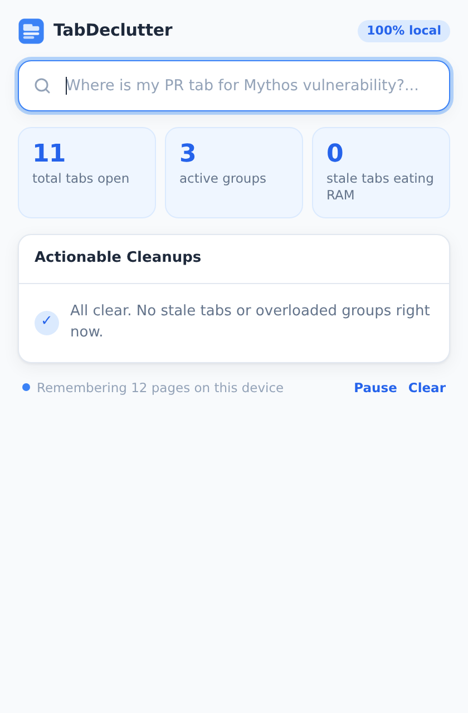
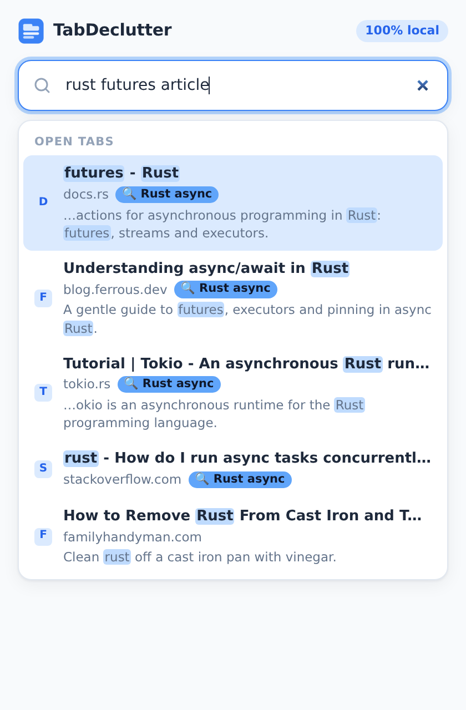
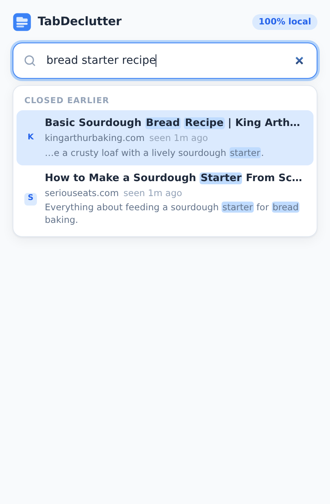

# TabDeclutter

**Too many tabs open? TabDeclutter tidies them up for you.** It groups related tabs automatically, reminds you about tabs you have forgotten, and lets you find any page, open or already closed, by typing what you remember about it.

Everything runs inside your browser. No account, no servers, no data leaves your computer.

  
  
  

## What it does

- **Groups your tabs automatically.**
  - Tabs about the same topic on different websites are grouped together, for example a tutorial, a blog post, and a forum question about the same thing all go into `🔍 Rust async`.
  - Other tabs are grouped by website (`GitHub`, `Python`, `YouTube`, …). Busy sites like YouTube, Google, and Stack Overflow get smaller groups by subject, such as `YouTube · lofi`.
- **Finds any page by what you remember.** Type a few words, like "rust article about pinning", "that piano video", or "bread starter recipe". It searches your open tabs and pages you closed earlier, including the words inside the pages, not just their titles.
- **Reminds you about forgotten tabs.** A tab you have not looked at for 2+ hours counts as "stale". The toolbar icon shows how many you have, and you get a gentle reminder now and then.
- **Closes tabs safely.** "Archive & Safe Close" saves the page title and link to a history list before closing it, so you can always reopen it later.

## Install (about 2 minutes)

TabDeclutter is not on the Chrome Web Store yet, so it is installed from a download. Works in Google Chrome, Microsoft Edge, Brave, and other Chromium browsers (version 102 or newer).

1. **Download** `TabDeclutter.zip` from the [latest release](https://github.com/saichethanr/TabDeclutter/releases/latest) (under **Assets**).
2. **Unzip it.** On Windows, right-click the file → **Extract All…** → **Extract**. On a Mac, double-click it.
   Open the new folder and check that you can see `manifest.json` directly inside it. That is the folder you will select in step 5.
3. **Open the extensions page.** Type `chrome://extensions` into the address bar and press Enter. (In Edge: `edge://extensions`.)
4. **Turn on Developer mode** with the switch in the top-right corner (bottom-left in Edge).
5. **Click "Load unpacked"** and select the folder from step 2.
6. **Pin it to the toolbar.** Click the puzzle-piece icon next to the address bar, then the pin next to **TabDeclutter**.

Keep the unzipped folder where it is (for example in Documents). Chrome loads the extension from it, so deleting or moving the folder removes the extension.

When it loads, TabDeclutter starts grouping the tabs you already have open within a few seconds.

## How to use it

### Open TabDeclutter

Click the TabDeclutter icon in the toolbar, or press **Ctrl+Shift+K** (**⌘+Shift+K** on Mac).

### Find a tab or a page you closed

1. Start typing in the search bar at the top. Describe the page however you remember it:
   - words from the title: `invoice export`
   - words from the page itself: `article about pinning futures`
   - the kind of site: `that piano video`, `the spreadsheet`, `my email`
   - typos are fine: `asynchronus runtime`
2. Results appear under **Open tabs** and **Closed earlier**.
3. Press **↑ / ↓** to choose and **Enter** to open it, or just click a result. Open tabs are brought to the front; closed pages reopen in a new tab.

Tip: words like *PR*, *pull request*, *issue*, or *code* bring your GitHub tabs to the top.

### Let tabs group themselves

There is nothing to do: groups appear and update as you browse.

- **Rename or recolor** a group by right-clicking its label in the tab bar. TabDeclutter keeps your changes.
- **Keep a tab out of a group** by dragging it out. It stays out until you visit a different page in that tab.
- **Your own groups** (ones you create yourself) are never touched.

### Clean up

The popup shows three numbers: total tabs open, active groups, and stale tabs.

Under **Actionable Cleanups** you will see:
- **Stale tabs**: pages you have not looked at for 2+ hours.
- **Overloaded groups**: automatic groups with more than 7 tabs.

Click **Archive & Safe Close** next to an item, or **Archive all stale** at the top. For an overloaded group, only the least-recently-used tabs are closed until 7 remain. Tabs you are looking at, pinned tabs, and tabs playing sound are never closed.

### Reopen something you archived

Open **Recently archived** at the bottom of the popup and click any entry to reopen it. Archived pages also show up in search.

### Page memory: Pause and Clear

The line at the bottom of the popup shows how many pages TabDeclutter remembers.
- **Pause** stops remembering new pages (click **Resume** to turn it back on).
- **Clear** deletes everything it remembers (click twice to confirm).

## Updating to a new version

1. Download the new `TabDeclutter.zip` from the [latest release](https://github.com/saichethanr/TabDeclutter/releases/latest) and unzip it.
2. Copy its files into your existing TabDeclutter folder and choose **Replace** when asked.
3. Go to `chrome://extensions` and click the **↻** (reload) icon on the TabDeclutter card.

Your history and remembered pages are kept.

## Removing it

Go to `chrome://extensions` and click **Remove** on the TabDeclutter card. This also deletes everything it stored. You can then delete the folder.

## Troubleshooting

| Problem | Fix |
| --- | --- |
| "Manifest file is missing or unreadable" | You selected the wrong folder. Unzipping often creates a folder inside a folder. Select the one that has `manifest.json` directly inside it. |
| Tabs are not being grouped | Wait a few seconds, or reload the tab. On the TabDeclutter card in `chrome://extensions`, click **Details** and check that **Site access** is set to **On all sites**. |
| Search doesn't find a page | It only knows pages opened after it was installed (and not while paused). Try fewer or different words. |
| No stale tabs listed | A tab only becomes stale after 2 hours unused. |
| Chrome warns about developer mode extensions | This is normal for extensions installed from a download. Close the warning; don't click **Disable**. |
| Gmail won't let me send the zip | Gmail blocks zip files that contain code. Share the [release link](https://github.com/saichethanr/TabDeclutter/releases/latest) instead. |
| Work or school computer won't allow "Load unpacked" | Your administrator has disabled it; ask them, or use a personal browser profile. |

## Privacy

- Everything is stored in your own browser. Nothing is uploaded, and there are no accounts, analytics, or ads.
- To group by topic and search inside pages, TabDeclutter reads each page's title, description, headings, and most frequent words. Chrome describes this permission as "Read and change all your data on all websites". TabDeclutter only reads, and it keeps a short summary per page, not the full text.
- Pages with a password field (such as login and banking pages) are never remembered, and incognito windows are ignored.
- You can pause or clear page memory at any time from the popup.

## For developers

| File | Role |
| --- | --- |
| `manifest.json` | Manifest V3 configuration and permissions. |
| `background.js` | Service worker: last-access tracking, page memory indexing, the topic and site grouping engine, badge, and notifications. |
| `popup.html` / `popup.js` | Dashboard, cleanup actions, page memory controls, and the command bar search. |
| `shared.js` | Storage keys, thresholds, text helpers, and the IndexedDB page memory used by both contexts. |
| `styles.css` | All styles; no remote assets, so it works under the strict extension CSP. |

How it decides:
- **Topics**: each tab gets a TF-IDF word profile from its title, headings, description, URL, and frequent page words. Tabs from at least two different sites with similar profiles form a topic group. Only tabs that are ungrouped, just navigated, or sit in a topic or general catch-all group are re-evaluated, and a group left with one tab dissolves.
- **Stale**: the last time each tab was in the foreground is tracked in `chrome.storage.local`; a background tab is stale after 2 hours.
- **Search**: scores title, site, URL, and remembered page words, with light word-stemming, typo tolerance, site-type words (video, spreadsheet, email, …), and extra weight for GitHub on code-related queries.

To work on it, clone the repository and use **Load unpacked** on the folder. After editing, click **↻** on the extension card.
